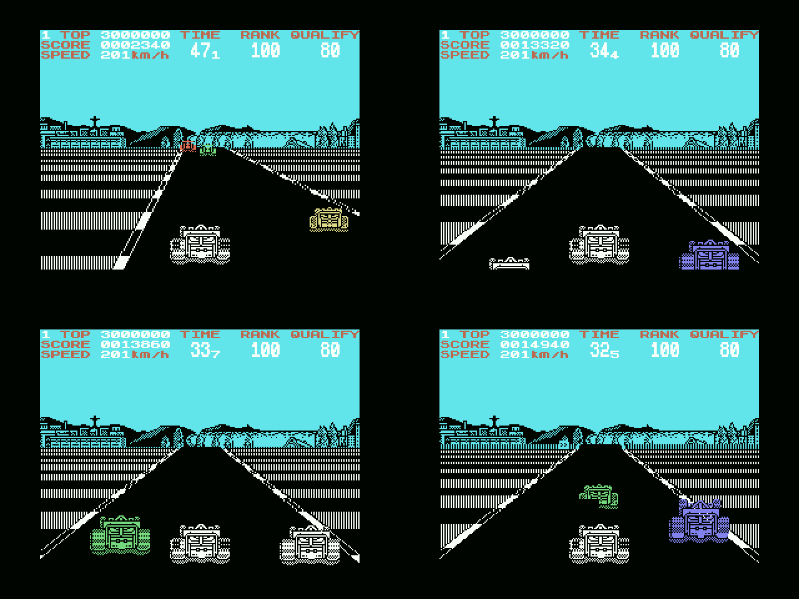
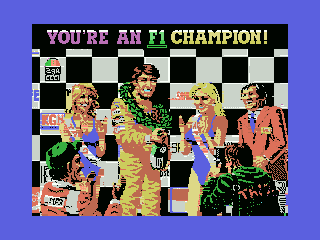

# Continental Circus Enhanced (MSX)

[Español](README.md) · **English** · [日本語](README.ja.md)

An improved version of the MSX conversion of **Continental Circus**, Taito's 1987 arcade game. The MSX version came out on tape in 1989 from Virgin Mastertronic. It is a direct port of the ZX Spectrum version, converted by NEW FRONTIER with code by S. Casamiquela.

It is now a MegaROM with no tape loading, runs at almost twice the frame rate, shows the rivals in colour and has PSG music and sound effects.



## Download

- [`releases/ContinentalCircus_Enhanced_v1.0.rom`](releases/ContinentalCircus_Enhanced_v1.0.rom): **v1.0**, 256 KB **ASCII8** MegaROM.
  - SHA-1: `1a067c66ccf9b57c7da0d1251f9dccff6c5e6909`
  - Runs on any MSX with 64 KB of RAM, expanded slots included. Tested in openMSX on MSX1, MSX2 and MSX2+ (C-BIOS), on an emulated Sony HB-20P and on turbo R.
  - openMSX and BlueMSX detect the mapper automatically. If another emulator does not, select ASCII8 by hand.

## Controls

| | Keyboard | Joystick (menu option 3) |
|---|---|---|
| Steer | Cursor left and right | Left and right |
| Accelerate | Cursor up | Fire |
| Brake | Cursor down | Down |
| Change gear | SPACE | Up |
| Pause / quit | STOP / ESC | |

RETURN starts the game. Keys can be redefined with menu option 2.

## What is new

- **Almost twice as fast:** during a race it goes from 3.8 to 7.25 frames per second on MSX1.
  - The screen copy uses the VDP auto-increment and does not resend the sky when it has not changed.
  - The score panel is printed with a direct routine, about five times faster, and a fixed delay was removed.
  - The race clock counts per frame, so the difficulty is the same as the original.
  - On turbo R the game switches itself to the R800 and runs much faster.
- **256 KB MegaROM:** the nine circuits are in the ROM and there is no more tape loading.
- **Rivals in colour, with sprites:** red, light blue, yellow, green and magenta, also when they are right beside you.
- **PSG sound** (the original was silent on MSX):
  - Engine, bumps, crashes and brake, using the formula and effects of Konami's Hyper Rally.
  - Start lights, overtaking, extra time and fanfares at the end of the race.
  - Each circuit map plays its arcade music, arranged for the PSG.
- **Brake** on cursor down.
- **Fairer crashes:** the original crashed you into rivals that, on bends, were drawn far away and to one side. Now the two cars have to touch on screen.
- **New final screen:** the arcade's podium artwork converted to SCREEN 2 and retouched by hand by araubi.



The technical documentation is in [`docs/en/DOCUMENTATION.md`](docs/en/DOCUMENTATION.md) and the lessons for other projects in [`docs/en/LESSONS.md`](docs/en/LESSONS.md).

## How to build

The repository **contains nothing from the original game**. You need both sides of **your own tape**:

| Side | File | SHA-1 |
|---|---|---|
| A | `Continental_Circus_SideA.cas` | `a5a62d3f779caea14f62e7505d5874811f6504af` |
| B | `Continental_Circus_SideB.cas` | `d36e8832612a9e949a8b38735f6397b05edbfedf` |

You also need Python 3 with Pillow, gcc and [sjasmplus](https://github.com/z00m128/sjasmplus) 1.24.

```sh
cd fuentes
export SJASMPLUS=/path/to/sjasmplus     # if it is not in the PATH
python3 construir.py Continental_Circus_SideA.cas Continental_Circus_SideB.cas
```

The script patches side A with the fast screen copy and loads the game in a test emulator to take the memory image. It then builds the rival sprites from the rivals' pictures, assembles the code and puts the ROM together. With that tape, `fuentes/ContinentalCircus_Enhanced.rom` comes out byte-for-byte identical to the one in `releases/`.

### Contents

The folder and file names are in Spanish.

- `fuentes/prototipo3/`: fast screen copy, score panel and clock, applied on top of side A.
- `fuentes/emu/`: MSX test emulator in C (`msxemu.c`, with superzazu's Z80 core, MIT licence) and its Python harness.
- `fuentes/rom/`: `ccrom.asm` (boot, hooks, sound, sprites, brake, crashes, joystick and final screen) and `mkrom.py`, which builds the ROM.
- `fuentes/musica/`: PSG arrangements of the arcade music (`.song`) and the scripts that made them. The arcade recordings are not included.
- `fuentes/herramientas/`: final screen conversion, playback of openMSX `.omr` recordings, the overtaking sound and the disassembler.
- `fuentes/pruebas/`: openMSX scripts to measure speed and test the brake, the joystick and the final screen.

## Licence and notices

- **Own code** (`fuentes/`): MIT licence, see [`LICENSE`](LICENSE). The Z80 core in `fuentes/emu/z80.c` is by superzazu, also MIT ([`LICENSE_z80_superzazu.txt`](fuentes/emu/LICENSE_z80_superzazu.txt)).
- **Documentation, images and own graphic retouches:** CC BY-NC-SA 4.0, see [`LICENSE-CC`](LICENSE-CC).
- **Not covered by these licences:**
  - The original game (code, graphics and text) and the ROM in `releases/`, which contains it. They still belong to their owners: Taito (Continental Circus), Virgin Mastertronic and NEW FRONTIER (MSX version).
  - The arcade music and podium artwork, adapted here for the MSX but owned by Taito.
  - The Hyper Rally sound effects, owned by Konami.
- This is a non-profit tribute. It will be taken down if any rights holder asks.

## Credits

- **Continental Circus:** Taito, 1987. Arcade music: Masahiko Takaki.
- **MSX version:** Virgin Mastertronic, 1989. Converted by NEW FRONTIER, code by S. Casamiquela.
- **Sound effects:** Hyper Rally (Konami, 1985), extracted with the tools from [antxiko](https://github.com/antxiko)'s disassembly (MIT licence).
- **Enhanced version:** araubi (direction, testing and final screen retouch). Developed with Claude (Anthropic).
