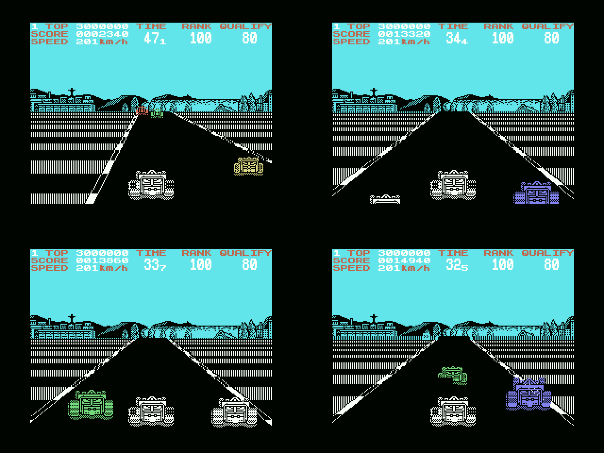
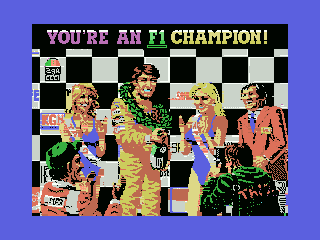

# Continental Circus Enhanced (MSX)

[Español](README.md) · [English](README.en.md) · **日本語**

タイトーのアーケードゲーム **Continental Circus**（コンチネンタルサーカス、1987年）の MSX 版を改良したものです。MSX 版は 1989 年に Virgin Mastertronic からカセットテープで発売されました。ZX Spectrum 版をそのまま移植したもので、移植は NEW FRONTIER、プログラムは S. Casamiquela です。

テープの読み込み待ちのない MegaROM になり、フレームレートは 2 倍以上、ライバル車はカラー表示、PSG による音楽と効果音が付きました。



## ダウンロード

- [`releases/ContinentalCircus_Enhanced_v1.1.rom`](releases/ContinentalCircus_Enhanced_v1.1.rom)：**v1.1**、256 KB の **ASCII8** MegaROM。
  - SHA-1：`fcac9df82058020378e2b0dfffde0c56aa4b561d`
  - v1.0 からの変更点（Francisco Delgado（FranSX74）氏による）：ギア表示、さらなる高速化、パナソニックの MSX2+ のターボ、turbo R での速度選択、全機種で同じ待ち時間、短くなったクラッシュ、速くなったマップ、ブレーキキーの変更。
  - v1.0 は [`releases/ContinentalCircus_Enhanced_v1.0.rom`](releases/ContinentalCircus_Enhanced_v1.0.rom) に残してあります（SHA-1 `1a067c66ccf9b57c7da0d1251f9dccff6c5e6909`）。
  - RAM 64 KB の MSX ならどの機種でも動きます（拡張スロットにも対応）。v1.0 は openMSX の MSX1・MSX2・MSX2+（C-BIOS）、エミュレートした Sony HB-20P、turbo R で動作確認済みです。v1.1 は openMSX の MSX1・MSX2・MSX2+・FS-A1WX・turbo R で確認しています。
  - openMSX と BlueMSX はメガロムの種類を自動で判別します。判別しないエミュレーターでは ASCII8 を手動で選んでください。

## 操作

| | キーボード | ジョイスティック（メニュー 3） |
|---|---|---|
| ハンドル | カーソル左右 | 左右 |
| アクセル | カーソル上 | トリガー |
| ブレーキ | カーソル下 | 下 |
| ギアチェンジ | スペース | 上 |
| ポーズ / 中断 | STOP / ESC | |

RETURN でゲーム開始。キーはメニュー 2 で変更できます（ブレーキも）。turbo R ではメニュー 4 で速度を選べます：`Normal`（ターボ付き MSX2+ 相当）、`Fast`、`Max`。

## 変更点

- **2 倍以上の速さ**：MSX1 でのレース中のフレームレートが毎秒 3.8 から、v1.0 で 7.25、v1.1 で 8.1 になりました（openMSX で 20 秒に 162 フレーム）。
  - 画面転送で VDP のオートインクリメントを使い、空は変化したときだけ送ります。
  - スコア表示を直接書き込むルーチンに替えて約 5 倍速くし、固定のウェイトを取り除きました。
  - レースのタイマーはフレーム単位で進むので、難易度はオリジナルと同じです。
  - turbo R では自動的に R800 に切り替わり、さらに速く動きます。
- **256 KB の MegaROM**：9 つのサーキットをすべて ROM に収め、テープの読み込みはありません。
- **スプライトによるカラーのライバル車**：赤・水色・黄・緑・マゼンタ。真横に並んだときもカラーです。
- **PSG のサウンド**（オリジナルの MSX 版は無音でした）：
  - エンジン音、接触、クラッシュ、ブレーキはコナミの「ハイパーラリー」の計算式と効果音を使っています。
  - スタートのシグナル、追い越し、エクステンドタイム、レース終了時のファンファーレ。
  - 各サーキットのマップ画面で、アーケード版の曲を PSG 用にアレンジして流します。
- **ブレーキ**：カーソル下。キーは変更できます（v1.1）。
- **全機種で同じ待ち時間**（v1.1）：スタートのシグナル、コンティニューのカウントダウン、イニシャル入力、メニューの長さが MSX1、ターボ付き MSX2+、turbo R で同じです。
- **turbo R での速度選択**（v1.1）：制限なしでは速すぎるので、標準ではターボ付き MSX2+ の速さで動きます。メニューの 4 キーで変更できます。
- **ギア表示**（v1.1）：速度の下に緑の `GEAR LOW` または赤の `GEAR HIGH`。オリジナルは `TOP` の前に `1` か `2` を出すだけでした。
- **少し速く**（v1.1）：展開した画面転送、変わった数字だけを書き直すスコア表示、軽くなった道路の生成。openMSX での測定で MSX1 は 14 %、MSX2 は 19 % 速くなりました。ターボ付きのパナソニックの MSX2+（FS-A1FX、FS-A1WX、FS-A1WSX）では起動時にターボを入れ、v1.0 より 50 % 速くなります。
- **短いクラッシュ**（v1.1）：スピンは 1 回だけで、9 秒が約 2 秒になりました。接触やクラッシュの後はローギアになります。
- **レース終了時のマップ**（v1.1）：コースを 2 倍の速さで描きます。
- **より公平な衝突判定**：オリジナルでは、カーブで遠く横の方に描かれているライバル車とも衝突していました。いまは画面上で 2 台が触れたときだけ衝突します。
- **新しいエンディング画面**：アーケード版の表彰台のイラストを SCREEN 2 に変換し、araubi が手作業で修正しました。



技術資料は [`docs/ja/DOCUMENTATION.md`](docs/ja/DOCUMENTATION.md)、ほかのプロジェクトに役立つ知見は [`docs/ja/LESSONS.md`](docs/ja/LESSONS.md) にあります。

## ビルド方法

このリポジトリには **オリジナルのゲームは一切含まれていません**。**お手持ちのテープ** の両面が必要です。

| 面 | ファイル | SHA-1 |
|---|---|---|
| A | `Continental_Circus_SideA.cas` | `a5a62d3f779caea14f62e7505d5874811f6504af` |
| B | `Continental_Circus_SideB.cas` | `d36e8832612a9e949a8b38735f6397b05edbfedf` |

ほかに Python 3（Pillow）、gcc、[sjasmplus](https://github.com/z00m128/sjasmplus) 1.24 が必要です。

```sh
cd fuentes
export SJASMPLUS=/path/to/sjasmplus     # PATH にない場合
python3 construir.py Continental_Circus_SideA.cas Continental_Circus_SideB.cas
```

スクリプトは A 面に高速な画面転送のパッチを当て、テスト用エミュレーターでゲームを読み込んでメモリイメージを取ります。続いてライバル車の画像からスプライトを作り、コードをアセンブルして ROM を組み立てます。このテープを使えば、`fuentes/ContinentalCircus_Enhanced.rom` は `releases/` の v1.1 とバイト単位で一致します。

テープがなくても、ゲームのメモリを含む公開済みの v1.0 から作れます。必要なのは Python 3 と sjasmplus だけです：

```sh
cd fuentes
python3 construir_desde_rom.py        # releases/ContinentalCircus_Enhanced_v1.0.rom から作ります
```

できあがりは v1.1 と同じように遊べますが、バイト単位では一致しません。もう使われていない領域（1193h-119Fh と 16C6h-16DAh）に v1.0 の 33 バイトが残るためです。

### 内容

フォルダ名とファイル名はスペイン語です。

- `fuentes/prototipo3/`：A 面に当てる高速な画面転送、スコア表示、タイマー。
- `fuentes/emu/`：C で書いたテスト用 MSX エミュレーター（`msxemu.c`、superzazu 氏の Z80 コア、MIT ライセンス）と Python のハーネス。
- `fuentes/rom/`：`ccrom.asm`（起動、フック、サウンド、スプライト、ブレーキ、衝突、ジョイスティック、エンディング画面）と、ROM を組み立てる `mkrom.py`。
- `fuentes/musica/`：アーケード版の曲の PSG 用アレンジ（`.song`）と、それを作ったスクリプト。アーケード版の録音は含みません。
- `fuentes/herramientas/`：エンディング画面の変換、openMSX の `.omr` リプレイの再生、追い越しの効果音、逆アセンブラ。
- `fuentes/pruebas/`：速度の計測と、ブレーキ・ジョイスティック・エンディング画面を確認する openMSX 用スクリプト。

## ライセンスと注意事項

- **自作のコード**（`fuentes/`）：MIT ライセンス。[`LICENSE`](LICENSE) を参照。`fuentes/emu/z80.c` の Z80 コアは superzazu 氏によるもので、こちらも MIT ライセンスです（[`LICENSE_z80_superzazu.txt`](fuentes/emu/LICENSE_z80_superzazu.txt)）。
- **ドキュメント、画像、自作のグラフィック修正**：CC BY-NC-SA 4.0。[`LICENSE-CC`](LICENSE-CC) を参照。
- **これらのライセンスの対象外のもの**：
  - オリジナルのゲーム（コード、グラフィック、テキスト）と、それを含む `releases/` の ROM。権利は各権利者にあります：タイトー（Continental Circus）、Virgin Mastertronic と NEW FRONTIER（MSX 版）。
  - アーケード版の音楽と表彰台のイラスト。MSX 用に手を加えていますが、権利はタイトーにあります。
  - ハイパーラリーの効果音。権利はコナミにあります。
- 非営利のトリビュートです。権利者から要請があれば公開を取りやめます。

## クレジット

- **Continental Circus**：タイトー、1987年。アーケード版の音楽：Masahiko Takaki。
- **MSX 版**：Virgin Mastertronic、1989年。移植 NEW FRONTIER、プログラム S. Casamiquela。
- **効果音**：ハイパーラリー（コナミ、1985年）。[antxiko](https://github.com/antxiko) 氏の逆アセンブルのツールで抽出（MIT ライセンス）。
- **改良版**：araubi（ディレクション、テスト、エンディング画面の修正）。Claude（Anthropic）を使って開発。
- **v1.1 の改良**：Francisco Delgado（[FranSX74](https://github.com/FranSX74)）。
