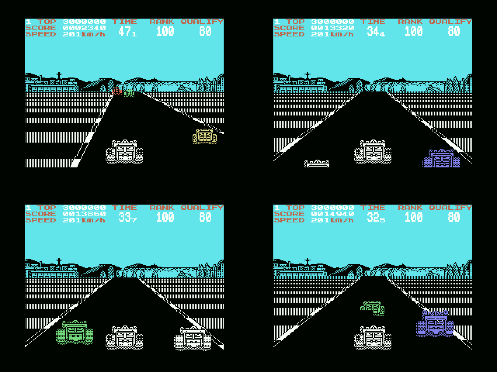
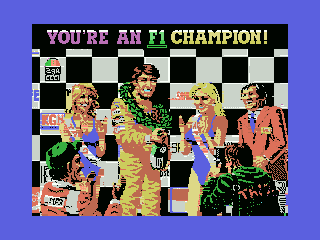

# Continental Circus Enhanced (MSX)

**Español** · [English](README.en.md) · [日本語](README.ja.md)

Versión mejorada de la conversión MSX de **Continental Circus**, la recreativa de Taito (1987). La versión MSX salió en cinta en 1989 con Virgin Mastertronic: es un port directo de la de ZX Spectrum, con conversión de NEW FRONTIER y código de S. Casamiquela.

Ahora es una MegaROM sin esperas de cinta, va a más del doble de imágenes por segundo, los rivales salen en color y tiene música y efectos con el PSG.



## Descarga

- [`releases/ContinentalCircus_Enhanced_v1.1.rom`](releases/ContinentalCircus_Enhanced_v1.1.rom): **v1.1**, MegaROM **ASCII8** de 256 KB.
  - SHA-1: `fcac9df82058020378e2b0dfffde0c56aa4b561d`
  - Novedades frente a la v1.0, de Francisco Delgado (FranSX74): indicador de marcha, algo más de velocidad, turbo de los MSX2+ de Panasonic, velocidad a elegir en turbo R, esperas iguales en todas las máquinas, accidentes más cortos, mapa más rápido y tecla de freno redefinible.
  - La v1.0 sigue en [`releases/ContinentalCircus_Enhanced_v1.0.rom`](releases/ContinentalCircus_Enhanced_v1.0.rom) (SHA-1 `1a067c66ccf9b57c7da0d1251f9dccff6c5e6909`).
  - Funciona en cualquier MSX con 64 KB de RAM, también con slots expandidos. La v1.0 se probó en openMSX con MSX1, MSX2 y MSX2+ (C-BIOS), en un Sony HB-20P emulado y en turbo R. La v1.1 se ha probado en openMSX con MSX1, MSX2, MSX2+, FS-A1WX y turbo R.
  - openMSX y BlueMSX detectan el mapper solos. Si otro emulador no lo hace, hay que elegir ASCII8 a mano.

## Controles

| | Teclado | Joystick (opción 3 del menú) |
|---|---|---|
| Girar | Cursores izquierda y derecha | Izquierda y derecha |
| Acelerar | Cursor arriba | Disparo |
| Frenar | Cursor abajo | Abajo |
| Cambiar de marcha | ESPACIO | Arriba |
| Pausa / abandonar | STOP / ESC | |

RETURN empieza la partida. Las teclas se pueden redefinir con la opción 2 del menú (también la de frenar). En turbo R hay una opción 4 para elegir la velocidad: `Normal` (como un MSX2+ con turbo), `Fast` o `Max`.

## Qué cambia

- **Más del doble de rápido:** en carrera pasa de 3,8 imágenes por segundo en MSX1 a 7,25 con la v1.0 y a 8,1 con la v1.1 (162 en 20 s en openMSX).
  - El volcado de pantalla aprovecha el autoincremento del VDP y no reenvía el cielo si no cambia.
  - El marcador se escribe con una rutina directa, unas cinco veces más rápida, y se quitó una espera fija.
  - El reloj de carrera cuenta por imagen, así que la dificultad es la del original.
  - En turbo R el juego pasa solo al R800 y va mucho más rápido.
- **MegaROM de 256 KB:** los nueve circuitos van en la ROM y ya no hay cargas de cinta.
- **Rivales en color con sprites:** rojo, azul claro, amarillo, verde y magenta, también cuando están a tu lado.
- **Sonido con el PSG** (el original no tenía nada en MSX):
  - Motor, golpes, choques y freno con la fórmula y los efectos del Hyper Rally de Konami.
  - Semáforo de salida, adelantamientos, tiempo extra y fanfarrias al acabar la carrera.
  - En el mapa de cada circuito suena su música de la recreativa, arreglada para el PSG.
- **Freno** con el cursor abajo. La tecla se puede redefinir (v1.1).
- **Esperas iguales en todas las máquinas** (v1.1): el semáforo, la cuenta atrás de continuar, las iniciales y los menús duran lo mismo en MSX1, MSX2+ con turbo y turbo R.
- **Velocidad a elegir en turbo R** (v1.1): sin límite el juego corre demasiado, así que por defecto va a la velocidad de un MSX2+ con turbo; se cambia con la tecla 4 del menú.
- **Indicador de marcha** (v1.1): `GEAR LOW` en verde o `GEAR HIGH` en rojo bajo la velocidad. El original solo ponía un `1` o un `2` delante de `TOP`.
- **Un poco más rápido** (v1.1): volcado desenrollado, marcador que solo reimprime las cifras que cambian y generador de carretera más ligero. Medido en openMSX: un 14 % más en MSX1 y un 19 % más en MSX2. En los MSX2+ de Panasonic con turbo (FS-A1FX, FS-A1WX, FS-A1WSX) lo activa al arrancar: un 50 % más que la v1.0.
- **Accidentes más cortos** (v1.1): un solo trompo y unos 2 s en vez de 9. Tras un toque o un accidente el coche queda en marcha corta.
- **Mapa de fin de carrera** (v1.1): el recorrido se pinta al doble de velocidad.
- **Choques más justos:** el original chocaba con rivales que en las curvas se veían lejos y a un lado. Ahora hace falta que los dos coches se toquen en pantalla.
- **Pantalla final nueva:** la ilustración del podio de la recreativa pasada a SCREEN 2 y retocada a mano por araubi.



La documentación técnica está en [`docs/es/DOCUMENTACION.md`](docs/es/DOCUMENTACION.md) y lo aprendido para otros proyectos, en [`docs/es/LECCIONES.md`](docs/es/LECCIONES.md).

## Cómo se compila

El repositorio **no incluye nada del juego original**. Hacen falta las dos caras de **tu propia cinta**:

| Cara | Fichero | SHA-1 |
|---|---|---|
| A | `Continental_Circus_SideA.cas` | `a5a62d3f779caea14f62e7505d5874811f6504af` |
| B | `Continental_Circus_SideB.cas` | `d36e8832612a9e949a8b38735f6397b05edbfedf` |

También hacen falta Python 3 con Pillow, gcc y [sjasmplus](https://github.com/z00m128/sjasmplus) 1.24.

```sh
cd fuentes
export SJASMPLUS=/ruta/a/sjasmplus     # si no está en el PATH
python3 construir.py Continental_Circus_SideA.cas Continental_Circus_SideB.cas
```

El script parchea la cara A con el volcado rápido y carga el juego en un emulador de pruebas para sacar la memoria. Después saca los sprites de las imágenes de los rivales y ensambla y monta la ROM. Con esa cinta, `fuentes/ContinentalCircus_Enhanced.rom` sale idéntica byte a byte a la v1.1 de `releases/`.

Sin las cintas se puede construir a partir de la ROM publicada, que ya lleva la memoria del juego. Solo hacen falta Python 3 y sjasmplus:

```sh
cd fuentes
python3 construir_desde_rom.py        # parte de releases/ContinentalCircus_Enhanced_v1.0.rom
```

El resultado juega igual que la v1.1, pero no es idéntico byte a byte: conserva 33 bytes de la v1.0 en huecos que ya no usa nadie (1193h-119Fh y 16C6h-16DAh).

### Contenido

- `fuentes/prototipo3/`: volcado rápido, marcador y reloj, que se aplican sobre la cara A.
- `fuentes/emu/`: emulador MSX de pruebas en C (`msxemu.c`, con el núcleo Z80 de superzazu, licencia MIT) y su arnés en Python.
- `fuentes/rom/`: `ccrom.asm` (arranque, enganches, sonido, sprites, freno, choques, joystick y pantalla final) y `mkrom.py`, que monta la ROM.
- `fuentes/musica/`: arreglos de las músicas de la recreativa para el PSG (`.song`) y los scripts que los hicieron. Las grabaciones de la recreativa no se incluyen.
- `fuentes/herramientas/`: conversión de la pantalla final, reproducción de grabaciones `.omr` de openMSX, el sonido de adelantar y el desensamblador.
- `fuentes/pruebas/`: scripts de openMSX para medir la velocidad, el freno, el joystick y la pantalla final.

## Licencia y avisos

- **Código propio** (`fuentes/`): licencia MIT, ver [`LICENSE`](LICENSE). El núcleo Z80 de `fuentes/emu/z80.c` es de superzazu, también con licencia MIT ([`LICENSE_z80_superzazu.txt`](fuentes/emu/LICENSE_z80_superzazu.txt)).
- **Documentación, imágenes y retoques gráficos propios:** CC BY-NC-SA 4.0, ver [`LICENSE-CC`](LICENSE-CC).
- **Lo que no cubren estas licencias:**
  - El juego original (código, gráficos y textos) y la ROM de `releases/`, que lo contiene. Siguen siendo de sus titulares: Taito (Continental Circus), Virgin Mastertronic y NEW FRONTIER (versión MSX).
  - La música y la ilustración del podio de la recreativa, que aquí van adaptadas al MSX pero son de Taito.
  - Los efectos de sonido del Hyper Rally, que son de Konami.
- Es un homenaje sin ánimo de lucro. Si algún titular lo pide, se retira.

## Créditos

- **Continental Circus:** Taito, 1987. Música de la recreativa: Masahiko Takaki.
- **Versión MSX:** Virgin Mastertronic, 1989. Conversión de NEW FRONTIER, código de S. Casamiquela.
- **Efectos de sonido:** Hyper Rally (Konami, 1985), sacados con las herramientas del desensamblado de [antxiko](https://github.com/antxiko) (licencia MIT).
- **Versión mejorada:** araubi (dirección, pruebas y retoque de la pantalla final). Desarrollado con Claude (Anthropic).
- **Mejoras de la v1.1:** Francisco Delgado ([FranSX74](https://github.com/FranSX74)).
